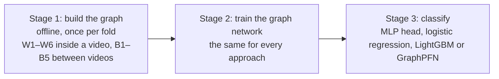

# Manual: comparing ways to build the graph for multimodal sexism video classification

The main point: does the way the graph is built change how well a graph network detects sexism and annotator disagreement in multimodal TikTok videos? If it does, which way works best, and at what cost? Every approach uses the same features, graph network, classifier and metrics, so differences come only from how the graph is built. Do the steps in order; each ends with a check that must pass before the next step.

## Main point

The current model (C0) fuses the VLM description, transcript, video and physiology streams with cross-attention and treats each video on its own. A graph can make two kinds of structure explicit. Inside a video, it links the parts: the four VLM fields, the transcript sentences and the clips. Between videos, it links a video to similar training videos whose annotator labels are known.

Such graphs can be built in many ways, from plain similarity to edges chosen by a VLM or learned during training. Published graph systems for harmful content usually pick one way, so it is unclear which construction choices matter. This work builds the graph in eleven ways from the same videos and keeps everything else fixed. Controls with no edges, random edges or every possible edge show whether structure helps at all.

Either outcome answers the question. A clear winner shows which structure to use and why it helps. A measured tie shows that, at this data size, the structure does not matter and the cheapest graph is enough.

The work has five goals:

- **Goal 1. Compare the ways of building the graph fairly.** It answers four questions:
    - **Q1, inside a video (Step 24).** Which way of building a video's own graph works best: modalities as nodes, segments as nodes, VLM-built edges, learned edges, a hypergraph, or two graphs (dual-stream)?
    - **Q2, between videos (Step 25).** Which way of linking a video to similar training videos works best: kNN similarity, VLM-built links, learned links, theme hyperedges, or an in-context graph head?
    - **Q3, together (Steps 26–27).** Does the best approach of each kind work better combined, and with which readout and classifier?
    - **Q4, reference (Step 30).** Does any approach beat the current cross-attention model?
- **Goal 2. Test the VLM as the graph builder.** Do edges and links chosen by Qwen3-VL beat those built from similarity or learned in training?
- **Goal 3. Test whether neighbours' labels predict disagreement.** Do the annotator distributions of similar training videos help predict how much annotators disagree?
- **Goal 4. Weigh cost against benefit.** What does each approach cost to build and train, against what it gains?
- **Goal 5. Find what the model relies on.** Which modalities, fields and links matter, and does physiology carry real signal?

The tasks that deliver each goal are in the [To-do list](#to-do-list-for-the-five-goals) section below.

## The approaches compared

Eleven approaches come from the graph construction cheat sheet: six build the graph inside a video (W) and five link a video to similar training videos (B). Five controls (C) show what no structure, random structure, full connection, a plain kNN vote and the current model achieve.

| ID | Approach | Nodes | How the edges are made | Cheat sheet |
| --- | --- | --- | --- | --- |
| W1 | modalities as nodes | one per modality, plus the hub | all pairs of modality nodes | method 1 |
| W2 | segments as nodes | VLM fields, sentences, clips, hub | time order inside a modality, same window across modalities, field-to-clip and field-to-sentence similarity | method 2 |
| W3 | VLM-built edges | as W2 | Qwen3-VL names the clips and sentences that support each field | method 3 |
| W4 | learned edges | as W2 | a scorer rates every node pair and keeps the top k, trained with the task | method 4 |
| W5 | hypergraph | as W2 | one hyperedge per moment: its clip, its sentences and its fields | hypergraph |
| W6 | dual-stream | as W2 | W2's edges for content, plus a graph over the moments that weights them | dual-stream |
| B1 | kNN links | the video plus its nearest training videos | cosine similarity of the video vectors | method 1, between examples |
| B2 | VLM-built links | the video plus linked training videos | Qwen3-VL confirms a shared target, message, parody or reply; shared author, sound or hashtag | method 3 |
| B3 | learned links | the video plus chosen training videos | a scorer picks from the 50 nearest, trained with the task | method 4 |
| B4 | theme hyperedges | the video plus its cluster | one hyperedge per cluster of training videos with the same VLM target | hypergraph |
| B5 | in-context graph head | videos, with kNN edges | GraphPFN predicts from the labelled training videos in one pass, without training | GraphPFN |
| C0 | current model | tokens per modality | cross-attention | control: the paper |
| C1 | no edges | as W2 | none: each node is encoded alone, then pooled | control |
| C2 | random edges | as W2 | random, the same number per relation as W2 | control |
| C3 | fully connected | as W2 | every pair, with typed relations | control |
| C4 | kNN vote | the video plus its nearest training videos | the similarity-weighted mean of their soft labels, no network | control |

The between-video approaches all start from the best inside-video graph, so they differ only in how videos are linked.

## The three stages

Stage 1 runs offline once per fold. Stages 2 and 3 train on cached features that are identical for every model compared.

_The three stages: one graph per video._

Each input becomes a node type, retrieval adds neighbour videos from the training fold only, and the graph embedding goes to the classifier.

## Before you start

You need the videos, the transcripts, the four VLM fields per video from the paper's pipeline, the physiological features, the annotator labels, and the paper's code and saved predictions.

- **Label sets.** Binary (sexist or not); intention (direct, judgemental or not sexist); categories (five sexism categories plus not sexist, several per video possible).
- **Software.** PyTorch Geometric, FAISS, PyEvALL, scikit-learn, LightGBM, GraphPFN, Hugging Face transformers and sentence-transformers, torchaudio, and Qwen3-VL-30B, the model the paper used, served locally through vLLM so that the W3 and B2 requests run in batches.
- **Rule 1.** Validation and test labels never enter features, edges, neighbour lists or any choice.
- **Rule 2.** Approaches differ only in how the graph is built. They share the features, folds, network, readout, classifier, losses, tuning budget and seeds.

## Part 1: set up the data and the baseline

These four steps fix the labels, the splits and the yardstick that every later model is measured with.

- [ ] **Step 1. Inventory the data and fix the labels.**
    - For each video, record its language, its annotators and their labels, whether the transcript has timestamps, and its physiology records.
    - Check whether the physiology subject IDs match the annotator IDs, and what the reaction-time field measures. Anything the files don't show becomes a written assumption.
    - Soft label: the share of annotators choosing each class (each category, for categories). Hard label: the class a majority chose; a category is on if at least half chose it. Videos without a majority are scored on soft metrics only.
    - Output: `videos.csv` (one row per video) and `data_note.md`.
- [ ] **Step 2. Make the folds.**
    - Split the training videos into 5 outer folds stratified by language and binary label, with 4 inner folds inside each for tuning.
    - Keep near-duplicates (perceptual hashes of keyframes, for example with `imagehash`) and same-author videos, if the data has author IDs, inside one fold.
    - Do not touch the test split until Step 31.
    - Output: `folds.csv` (video, outer fold, inner fold).
- [ ] **Step 3. Write the evaluation script.**
    - Input: soft and hard predictions for a set of videos. Output: ICM-Soft and ICM-Hard (PyEvALL, as in the paper), macro-F1, cross-entropy, Brier score and expected calibration error, overall and per language.
    - Add a paired bootstrap for comparing two models: resample videos within each language 10,000 times and recompute the metrics each time.
    - Done when: the true labels get the top score and the class prior scores near the bottom.
    - Output: `evaluate.py`.
- [ ] **Step 4. Re-run the current model (C0).**
    - Train the paper's cross-attention model on the new folds with 5 seeds for each label set: 75 runs. Start these first; they take longest.
    - Save the out-of-fold predictions. Their spread across seeds is the tolerance for every later comparison.
    - Done when: the seed spread is known and C0's scores are in the range of the paper's.
    - Output: `C0_oof.parquet` and `baseline_report.md`.

## Part 2: prepare the shared inputs

Every approach is built from these inputs. They are computed once and cached.

- [ ] **Step 5. Cut each video into moments.**
    - Split each video into 4 equal time windows; each window holds one of the paper's 4 evenly spaced 16-frame clips.
    - Split the transcript into sentences. If sentences lack timestamps, align the transcript text to the audio with torchaudio's MMS forced aligner instead of re-transcribing.
    - A moment is one window: its clip and the sentences whose midpoint falls inside it.
    - Output: `moments.parquet` (video, window, start, end, sentence IDs).
- [ ] **Step 6. Cache the node features.**
    - Run the frozen encoders once; all folds share the result.
    - Node features: XLM-R-large for the four VLM fields and the sentences, VideoMAE-base for the clips (mean-pooled tokens), and the Whisper encoder for each window's audio, used only if Step 23 keeps audio.
    - Video vectors for linking videos: BGE-M3 on TARGET + MESSAGE, BGE-M3 on the full transcript, and the mean SigLIP 2 embedding of the keyframes.
    - Done when: no values are missing and every video has its field and clip nodes. Count the videos without speech.
    - Output: `features/` (one file per node type and per video vector).
- [ ] **Step 7. Build the candidate lists for linking videos.**
    - Per outer fold and video vector, build a FAISS index over that fold's training videos only: `IndexFlatIP` on L2-normalised vectors gives cosine similarity.
    - For every video, store the 50 nearest training videos, excluding itself and its near-duplicate cluster. Test videos query each fold's index separately, so each test video gets five lists.
    - Output: `candidates_fold{k}.parquet` (video, source, rank, neighbour, similarity).
- [ ] **Step 8. Write the graph statistics script.**
    - For any built graph, report nodes and edges per video, density and isolated nodes. For links between videos, also report adjusted homophily and how often linked videos share the majority label.
    - Log each approach's build cost: wall-clock time, GPU-hours and VLM calls.
    - Output: `graph_stats.py`.

## Part 3: build one graph per approach

Each step turns the shared inputs into one approach's graph. Run `graph_stats.py` on every graph and add its row to `graph_stats.csv`.

Before Step 11, run a first slice end to end: write `train.py` (Step 22), train W2 and C1 on one outer fold, compute C4 (Step 20), and score all three with `evaluate.py`. Fix what breaks, and use the measured time per run to check the compute estimate.

- [ ] **Step 9. W2, segments as nodes.** Build it first: the controls and W3–W6 reuse its nodes.
    - Nodes: the four VLM fields, the sentences, the four clips and a hub node for the video.
    - next: consecutive sentences and consecutive clips. overlaps: each sentence to the clip of its window. field: all pairs of fields. member: every node to the hub.
    - grounds: each field to the 2 clips whose keyframes best match it in SigLIP 2. SigLIP 2 reads at most 64 text tokens and was trained on lower-cased text, so give it the field's first sentence in lower case.
    - paraphrases: each field to its 2 most similar sentences by BGE-M3 cosine, kept only if above the median of all field–sentence similarities.
    - Done when: a hand check of 50 grounding edges looks right.
- [ ] **Step 10. Controls C1–C3.** On W2's nodes: C1 has no edges, so each node is encoded alone and then pooled; C2 has random edges, the same number per relation as W2; C3 links every pair of nodes, with typed relations.
- [ ] **Step 11. W1, modalities as nodes.** One node per modality (the mean of its fields, sentences or clips) plus the hub, with typed edges between all of them.
- [ ] **Step 12. W3, VLM-built edges.**
    - One Qwen3-VL prompt per video: the 4 clips' keyframes, the numbered sentences and the four fields. Ask which clips and sentences support each field, answered as JSON.
    - These edges replace W2's grounds and paraphrases; next, overlaps, field and member stay. Use the same prompt for every video, with no labels, and re-run answers that are not valid JSON.
    - Done when: a hand check of 50 videos agrees with the answers.
- [ ] **Step 13. W4, learned edges.** Nothing is built in advance. During training, a scorer (a learned weighted cosine between node vectors) rates every pair of nodes in the video, keeps the top k per node and trains with the task, as in IDGL. W4 differs from C3 only in keeping the top k. Save the learned edges after training for inspection.
- [ ] **Step 14. W5, hypergraph.** One hyperedge per moment, holding its clip, its sentences and the fields grounded to that clip, plus one hyperedge for the four fields together.
- [ ] **Step 15. W6, dual-stream.** W2's graph gives each moment a content vector. A second small graph over the 4 moments, linked in time order and by similarity above the median, outputs one weight per moment. The video vector is the weighted sum of the moment vectors, as in MultiHateGNN.
- [ ] **Step 16. B1, kNN links.** Take the top k of each candidate list, with k from {3, 5, 10} chosen on inner folds. Each neighbour becomes a node holding its video vector and its soft label, linked to the hub by one edge per source that found it; similarity and rank are edge features.
- [ ] **Step 17. B2, VLM-built links.**
    - For each video's top 20 candidates among all training videos, ask Qwen3-VL whether the two descriptions share a target, message, parody or reply relation, answered as JSON. Judge each pair once; each fold keeps only the pairs whose neighbour is in its training part.
    - Add links between videos that share an author, sound or hashtag, if the data has these fields.
    - Done when: 200 pairs judged twice have their agreement reported.
- [ ] **Step 18. B3, learned links.** The 50 candidates from Step 7 go into training. A scorer (a learned weighted cosine between the two video vectors) keeps the top k and trains with the task, as in IDGL. Candidates come from the fold's training videos, not from the batch, so a prediction does not depend on which videos share its batch.
- [ ] **Step 19. B4, theme hyperedges.** Per outer fold, run k-means on the training videos' TARGET embeddings, with the number of clusters chosen on inner folds. Each cluster is one hyperedge; a validation or test video joins its nearest cluster.
- [ ] **Step 20. B5 and C4, prediction without a network.**
    - C4, kNN vote: the similarity-weighted mean of the neighbours' soft labels.
    - B5, GraphPFN: the fold's videos as nodes, edges to each video's k nearest training videos, and the frozen video vectors reduced to 64 dimensions with PCA as features. Training labels are the context; validation labels are set to NaN.
    - GraphPFN targets are the soft labels as regressions: the sexist share for binary, one regression per class for intention (renormalised), one per category for categories. Use it in-context; try the repository's light fine-tuning only if it loses to the kNN vote.
- [ ] **Step 21. Package the graphs.**
    - One PyTorch Geometric `HeteroData` per video, outer fold and approach. Neighbour nodes carry their soft labels.
    - Add an assertion that no validation or test video appears as a neighbour in any fold.
    - Done when: the assertion passes and `graph_stats.csv` has a row for every approach.
    - Output: `graphs/{approach}/fold{k}/` and `graph_stats.csv`.

## Part 4: train and compare the approaches

One training script runs every approach; only the graph changes.

- [ ] **Step 22. Write one training script for all approaches.**
    - Network: GATv2 with edge features, hidden size 128–256, 2 layers (tune 1–4; deeper message passing oversmooths), no added self-loops, mean aggregation across relations (`to_hetero(..., aggr="mean")`). Hypergraph approaches project all node types to one size and use `HypergraphConv`.
    - Readout for every approach: the hub vector, an attention-pooled vector per node type with a presence flag (an empty node type would otherwise pool to zeros), and a pooled vector over the neighbours. W6 replaces the pooling of moments with its own weights.
    - Head and losses as in the paper: the 3-layer MLP (2, 3 and 6 outputs for binary, intention and categories), soft cross-entropy with Dirichlet perturbation for binary and intention, weighted BCE with Beta perturbation for categories, and label smoothing 0.05 for binary and intention.
    - Regularisation: drop one node type with probability 0.15, drop links between videos at random, and hide each neighbour's label with probability 0.5 during training, as in UniMP.
    - Validate exactly as you test: each fold's model uses its own fold's neighbours, with neighbour labels visible. Stop early on validation loss.
    - Budget for every approach: 20 tuning trials per label set in each outer fold, each scored on one inner split (three inner folds train, one validates), then 5 seeds on the outer folds, following Errica et al.
    - Output: `train.py` and one config per approach.
- [ ] **Step 23. Decide on audio once.** Train W2 with and without audio-window nodes on inner folds. If audio helps, every approach gets audio nodes; otherwise none does.
- [ ] **Step 24. Compare the approaches inside a video.**
    - Run C1, C2, C3 and W1–W6, without any links between videos.
    - Compare each W with C1 using the paired bootstrap. Differences inside the interval are ties, and a tie goes to the cheaper approach.
    - Done when: the best inside-video approach is chosen and written in `choices.md`.
- [ ] **Step 25. Compare the approaches between videos.**
    - On the best inside-video approach, run B1–B4; B5 and C4 come from Step 20 and need no training.
    - Compare each B with the best inside-video approach alone. As an extra check, run B1 with the neighbour labels hidden, to see what the labels add.
    - Done when: the best between-video approach is chosen and written in `choices.md`.
- [ ] **Step 26. Combine and choose the readout.**
    - Join the best approach of each kind. If B5 or C4 wins, the combination is GraphPFN on the inside-video model's embeddings, which is classifier D in Step 27.
    - On the combination, compare the default readout with attention-MIL over the moments (Ilse et al.), for segment-based graphs. One moment can make a video sexist or put it in a category, but intention depends on the whole video, so keep the default readout for intention unless MIL is clearly better.
- [ ] **Step 27. Compare classifiers and calibrate.**
    - A: the MLP head trained with the network (the default). B and C: logistic regression and LightGBM on the graph embeddings, with each training video embedded by inner-fold networks that never saw it, and soft labels handled by repeating each video once per class, weighted by its share. D: GraphPFN as in Step 20, on the same embeddings.
    - For each fold, fit temperature scaling and the category thresholds on the other four folds' out-of-fold predictions, for every model.

### Comparison sheet

Fill in one row per approach as results arrive: ICM-Soft-Norm as the pooled out-of-fold mean with its bootstrap interval, plus edges per video and build cost from `graph_stats.csv`.

| ID | Binary | Intention | Categories | Edges per video | Build cost |
| --- | --- | --- | --- | --- | --- |
| W1 |  |  |  |  |  |
| W2 |  |  |  |  |  |
| W3 |  |  |  |  |  |
| W4 |  |  |  |  |  |
| W5 |  |  |  |  |  |
| W6 |  |  |  |  |  |
| B1 |  |  |  |  |  |
| B2 |  |  |  |  |  |
| B3 |  |  |  |  |  |
| B4 |  |  |  |  |  |
| B5 |  |  |  |  |  |
| C0 |  |  |  |  |  |
| C1 |  |  |  |  |  |
| C2 |  |  |  |  |  |
| C3 |  |  |  |  |  |
| C4 |  |  |  |  |  |

## Part 5: final checks and the test pass

The ranking of approaches is settled on cross-validation, then confirmed once on the test split.

- [ ] **Step 28. Run the controls and the physiology audit.**
    - Text only: XLM-R-large fine-tuned on the VLM fields plus the transcript.
    - C0 plus kNN: C0's out-of-fold predictions blended with the kNN soft labels, with the weight for each fold chosen on the other four.
    - Physiology stays out of every approach. Predict the labels from reaction time alone, from each signal group and from all signals; then add physiology nodes to the final model and compare. Keep them only if the audit clears them.
- [ ] **Step 29. Freeze.** Write the final choices, every approach's settings and the list of comparisons into `choices.md`. Nothing changes after this.
- [ ] **Step 30. Run the comparisons on cross-validation.**
    - Two families, each with Holm correction: every W against C1, and every B against the best inside-video approach alone. Also compare the final combination with C0.
    - Use ICM-Soft-Norm on pooled out-of-fold predictions for binary and intention. Categories stay exploratory because the rarest categories are very small.
    - As a rough guide for ICM-Hard-Norm, differences under about 2–3 points cannot be detected on pooled cross-validation, and differences under about 4–6 points cannot be detected on the test split alone.
- [ ] **Step 31. Score every approach once on the test split.**
    - Each fold's model predicts the test videos with its own fold's neighbours; average the five predictions. Score every approach and control once, overall and per language, to confirm the ranking.
    - Score the paper's eight modality configurations from their saved test predictions with the same script, as the reference. Five cells in the paper's tables don't fit the normalisation formula, and the trio and quad soft rows for categories are identical, so use these re-scored numbers.
- [ ] **Step 32. Find what the final model uses.** Remove one node type, relation or link type at a time at inference and measure the change in ICM. Rely on these deletion tests rather than on attention weights.

## Risks and fallbacks

The comparison is useful even if no approach wins clearly: a measured tie between ways of building the graph is itself a result.

| Risk | Early signal | Fallback |
| --- | --- | --- |
| No inside-video approach beats C1 | the Step 24 comparison | Record the tie and continue with the between-video approaches |
| kNN links same-topic videos with opposite intentions | low adjusted homophily in `graph_stats.csv` | Prefer B2 or B3 for intention |
| Frozen video features are too weak | C1–C3 far below C0 in Step 24 | Switch the clip features of every approach to SigLIP 2 keyframes |
| VLM-built edges are slow or inconsistent | judgments per hour; agreement in Step 17 | Distil the judgments into a small classifier on the two descriptions, or drop W3 and B2 with a note |
| Learned edges overfit | W4 below C3, or B3 below B1, on inner folds | Add SLAPS-style self-supervision, or score fewer candidates |
| Physiology is a proxy for the labels | the reaction-time probe in Step 28 | Keep physiology out, or use it only as a training target |
| Too many runs for the GPU | the training queue keeps growing | Use 3 seeds instead of 5, or 10 tuning trials instead of 20, for every approach |

**Compute (estimate):** about 6,000 short cached graph runs (190–490 GPU-hours at 2–5 minutes per run; several small runs can share the GPU at once), about 150 full runs of C0 and the text-only control (50–110 GPU-hours), and a few hours of batched VLM inference for W3 and B2 (tens of hours if requests run one at a time). B5 and C4 need no training. The first slice in Part 3 gives the real time per run. That fits on one H200, like the one used for the paper.

## To-do list for the five goals

Our five goals need 29 tasks: seven shared foundations, then each goal's own tasks. Step numbers point to the manual above, and that is the order to work in. Anything marked new is not in the manual yet.

### Foundation

Every goal depends on these seven tasks.

- [ ] **F1 Gather the inputs** (Before you start). Collect the videos, transcripts, four VLM fields, physiology, annotator labels, and the paper's code and saved predictions. Serve Qwen3-VL-30B on the H200 through vLLM. Done when everything loads and anything missing is listed in `data_note.md`.
- [ ] **F2 Fix the labels and the folds** (Steps 1–2). Leave the test split alone until Step 31. Done when `videos.csv` and `folds.csv` exist and no near-duplicate group or author is split across folds.
- [ ] **F3 Write the evaluation script** (Step 3). New: for binary and intention, also report every metric separately for unanimous videos (all annotators agreed) and split ones. Done when the true labels score top and the class prior scores near the bottom.
- [ ] **F4 Cache the shared inputs** (Steps 5–7): moments, node features, video vectors, and each video's 50 candidate neighbours from training videos only. Done when nothing is missing and every video has its field and clip nodes.
- [ ] **F5 Write the graph statistics script** (Step 8). New: log training GPU-hours next to the build cost, so learned edges carry their full cost. Done when it reports structure and cost for a sample graph.
- [ ] **F6 Write one training script and decide on audio** (Steps 22–23). Done when every approach runs from its own config with the same budget (20 tuning trials per label set in each outer fold, then 5 seeds) and the audio decision is in `choices.md`.
- [ ] **F7 Run a first slice end to end** (Steps 9–10, 20, 22). Train W2 and C1 on one outer fold with a first version of `train.py`, compute C4, and score all three. Done when all three beat the class prior and the real time per run is known.

### Goal 1. Compare the ways of building the graph fairly

Which way of building the graph works best inside a video (Q1), between videos (Q2) and combined (Q3), and does it beat the current model (Q4)? Ten tasks answer it.

- [ ] **1.1 Re-run the current model C0** (Step 4). Start it first, because its 75 runs take longest. Done when the seed spread is known and C0 scores within the paper's range.
- [ ] **1.2 Build W1, W2, W4–W6 and the controls C1–C3** (Steps 9–11, 13–15). W3 is task 2.1. Done when 50 grounding edges pass a hand check and each graph has its row in `graph_stats.csv` (W4's after training).
- [ ] **1.3 Build the links between videos and package all graphs** (Steps 16, 18–21). B1, B3 and B4 are graphs; B5 and C4 predict without training; B2 is task 2.2. Done when the leak assertion passes for every approach.
- [ ] **1.4 Q1: compare the approaches inside a video** (Step 24). Done when the best video graph is chosen and written in `choices.md`.
- [ ] **1.5 Q2: compare the approaches between videos** (Step 25). Done when the best way of linking videos is chosen and written in `choices.md`.
- [ ] **1.6 Q3: combine, then choose the readout, classifier and calibration** (Steps 26–27). Done when the final model is written in `choices.md`.
- [ ] **1.7 Run the text-only and C0-plus-kNN controls** (Step 28). Done when both are scored with the evaluation script.
- [ ] **1.8 Freeze** (Step 29). List every setting and every planned comparison, including tasks 2.3, 3.1 and 3.3. Done when `choices.md` is final.
- [ ] **1.9 Run the final comparisons on cross-validation** (Step 30). This answers Q4 and confirms Q1 and Q2. Done when both Holm families and the final model against C0 are reported, and the comparison sheet is complete.
- [ ] **1.10 Score everything once on the test split** (Step 31), including the paper's eight configurations. Done when the ranking is confirmed, or its changes reported, overall and per language.

### Goal 2. Test the VLM as the graph builder

Do edges and links chosen by Qwen3-VL beat those built from similarity or learned in training, and what do the VLM hours buy? Three tasks answer it.

- [ ] **2.1 Build W3, VLM-built edges inside a video** (Step 12). Done when a hand check of 50 videos agrees with the answers and the VLM hours are logged.
- [ ] **2.2 Build B2, VLM-built links between videos** (Step 17). Done when agreement on 200 pairs judged twice is reported and the VLM hours are logged.
- [ ] **2.3 Compare VLM-built edges with the alternatives** (new). On the Step 24 and 25 runs, compare W3 with W2 and W4, and B2 with B1 and B3, using the paired bootstrap. Done when each difference has its interval, shown next to the VLM hours it cost.

### Goal 3. Test whether neighbours' labels predict disagreement

Do the annotator distributions of similar training videos help predict how much annotators disagree, and which way of choosing neighbours does it best? Three tasks answer it.

- [ ] **3.1 Show versus hide the neighbour labels** (Step 25). Run B1 with the neighbour labels hidden. Done when the change in ICM-Soft and cross-entropy has its interval.
- [ ] **3.2 Rank the ways of choosing neighbours on soft metrics** (Steps 25 and 27). Compare B1–B5 and C4 on ICM-Soft, cross-entropy, Brier score and calibration error, after temperature scaling. Done when one table ranks them.
- [ ] **3.3 Split the scores by agreement** (new). Report the same metrics for unanimous and split videos: the final model, B1 with labels shown and hidden, C4, C0, and C0 plus kNN. Done when the table shows whether neighbour labels help most where annotators split.

### Goal 4. Weigh cost against benefit

What does each approach cost to build and train, and which is the cheapest one that matches the best? Two tasks answer it.

- [ ] **4.1 Log the full cost of every approach** (Step 8). Record build time, GPU-hours, VLM calls and training GPU-hours, one row per approach and control. Done when no row is missing a cost.
- [ ] **4.2 Plot score against cost** (new). One point per approach, with its interval. Done when the cheapest approach within the best one's interval is named, and the gap between GraphPFN (B5, no training) and the trained network is stated.

### Goal 5. Find what the model relies on

Which modalities, fields and links does the final model use, and does physiology carry real signal or only echo the annotators' labels? Three tasks answer it.

- [ ] **5.1 Audit physiology** (Step 28). Predict the labels from reaction time alone, from each signal group and from all signals. Done when the keep-or-drop decision is written in `choices.md`.
- [ ] **5.2 Run the deletion tests** (Step 32). New: also delete each VLM field alone, and TARGET with MESSAGE together. Done when a table shows the ICM change for each deletion and settles the paper's claim that target and message carry intention.
- [ ] **5.3 Inspect the edges** (new). Count the kinds of node pairs W4 keeps and the relations Qwen3-VL picks in W3 and B2, with 10 examples each. Done when the counts and examples are written up.

### Answers

The last task turns the results into one answer per goal.

- [ ] **A1 Write `results.md`** (new). One paragraph per goal with its main number and interval, plus the filled comparison sheet. Done when every goal has its answer.

## Sources

| Source | Used in |
| --- | --- |
| The team's working-notes paper (the attached PDF) | the current model C0, its settings and results |
| Graph construction cheat sheet (the attached PDF) | approaches W1–W6 and B1–B5 |
| [MultiHateGNN](https://arxiv.org/abs/2509.13515) (Yue et al., BMVC 2025) | W2 and W6 |
| [MemeWeaver](https://arxiv.org/abs/2601.08684) (Italiani et al., Findings of EACL 2026) | links learned between examples (B3) |
| [Attention-based deep MIL](https://arxiv.org/abs/1802.04712) (Ilse et al., 2018) | the MIL readout (Step 26) |
| [GraphEdit](https://arxiv.org/abs/2402.15183) (Guo et al., 2024) | W3 and B2 |
| [IDGL](https://arxiv.org/abs/2006.13009) (Chen et al., 2020) | W4 and B3 |
| [SLAPS](https://arxiv.org/abs/2102.05034) (Fatemi et al., 2021) | the fallback if learned edges overfit |
| [GraphPFN](https://proceedings.mlr.press/v306/eremeev26a.html) (Eremeev et al., ICML 2026; [code](https://github.com/yandex-research/graphpfn)) | B5 and classifier D |
| [HypergraphConv](https://pytorch-geometric.readthedocs.io/en/latest/generated/torch_geometric.nn.conv.HypergraphConv.html) (PyTorch Geometric) | W5 and B4 |
| [UniMP](https://arxiv.org/abs/2009.03509) (Shi et al., IJCAI 2021) | neighbour-label masking (Step 22) |
| [Adjusted homophily](https://proceedings.neurips.cc/paper_files/paper/2023/hash/01b681025fdbda8e935a66cc5bb6e9de-Abstract.html) (Platonov et al., NeurIPS 2023) | `graph_stats.py` (Step 8) |
| [A fair comparison of GNNs](https://arxiv.org/abs/1912.09893) (Errica et al., ICLR 2020) | controls C1–C3 |
